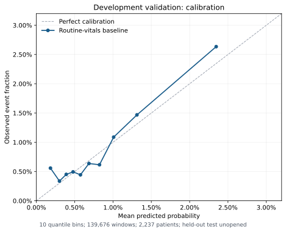

# ECG、完整風險集合與第一個開發基準

2026-11-01；protocol 0.3。以下為已完成的真實資料結果，**保留測試未開封**。全量 ECG 結果仍待完成，不能將部分快取的接受率當作全體估計。

## 完整風險集合與固定切分

由 protocol 0.2 的 23,327 次成人 ICU 重建全部逐小時風險集合。共 17,483 位患者，固定分為訓練 11,188、開發驗證 2,798、保留測試 3,497 位；包含沒有波形及不確定終點的成人患者，分組不由結果或波形品質決定。

| 完整風險集合 | 時窗數 |
|---|---:|
| 陽性 | 7,508 |
| 陰性 | 906,918 |
| 追蹤不足／其他治療截尾 | 100,177 |
| 總計 | **1,014,603** |

3,333 個主事件在首個六小時預測時間之前或當下發生，未能進入預警風險集合；1,529 個事件具有至少一個陽性時窗。過去六小時有 master record span 交集的時窗為 290,085，仍不代表 II 通道或品質合格。

## 常規生命徵象

完整掃描 `CHARTEVENTS` 330,712,483 列，依指定的七個 MetaVision ITEMID 選取心率、平均動脈壓、呼吸率與 SpO₂。11,107,169 列符合 ITEMID，其中 10,960,709 列屬目標 ICU；身分矛盾 0 列。依序排除錯誤／不明 error flag 6,991、無效數值 32,994、缺失／無效時間 2,106,977、觀察時間在追蹤外 27,526 列；未知單位 0 列。保留 **8,786,221 列、23,011 次 ICU**。

獨立抽查原表前 200 萬列中的 615,766 筆相關生命徵象：CHARTTIME 無缺失與非空解析失敗；149,774 筆 STORETIME 空白，非空解析失敗為 0，沒有小數秒格式造成的誤排除。此抽查未套全部隊列與數值條件，不能把比例直接外推成全表的精確原因分解。

模型只用 `CHARTTIME < t`、`STORETIME <= t` 且測量發生於過去六小時的最近可得值；同測量時刻的多筆已可得值取平均。缺失保持缺失，補值只在訓練患者擬合。ITEMID 與寬鬆數值界線參考 [MIMIC 官方 vital concept](https://github.com/MIT-LCP/mimic-code/blob/main/mimic-iii/concepts/pivot/pivoted_vital.sql)，時間語義參考 [CHARTEVENTS 官方文件](https://mimic.mit.edu/docs/iii/tables/chartevents.html)。六小時 freshness、精確單位與同時刻平均是本研究選擇。

## 已完成：生命徵象基準

模型為固定 C=1、無 class weighting 的 logistic regression，含年齡與隱匿年齡指標、四種生命徵象。補中位數、缺失指標、標準化皆只在訓練患者的非截尾時窗擬合。沒有調參或選最佳種子。

814,154 個開發時窗寫入模型表；200,449 個保留測試時窗在查詢生命徵象與 RR 特徵前即跳過。訓練使用 594,194 個非截尾時窗，來自 8,923 位患者；驗證的非截尾時窗為 139,676、2,237 位患者、247 個具有預警機會的事件。

| 開發驗證指標 | 數值 | 患者 bootstrap 95% 區間 |
|---|---:|---:|
| 陽性時窗比例 | 0.00873 | — |
| AUROC | 0.6798 | 0.6359–0.7175 |
| AUPRC（average precision） | 0.02669 | 0.01982–0.03936 |
| Brier | 0.008595 | 0.007292–0.009586 |

以訓練盛行率作固定機率的驗證 Brier 為 0.008652。改善幅度小，不能只因 Brier 數字低就宣稱預測準確。校準以十個 quantile bins 記錄，數據保存在私有開發報告。100 次患者層級 bootstrap 使用固定驗證預測、整組重抽患者，不重訓；區間沒有包含訓練過程的不確定性。Logistic regression 無收斂警告。

警報門檻固定為訓練陰性預測分數第 99 百分位（0.03288），驗證時每次 ICU 六小時內不重複通知。驗證共 457 次通知：28 次窗內有事件、373 次完整追蹤無事件、56 次結局追蹤不足而保持未知；另有 779 次超門檻被通知間隔抑制。

28／247 個事件被抓到，事件敏感度 **11.34%**；抓到事件的中位提前時間 **2.65 小時**。誤報為每 100 個實際已評分觀察病人小時 **0.242 次**；若分母只計結局可完整評估的觀察時間，為 **0.267 次**。兩個分母不同，不能混用。此門檻尚未依臨床工作負擔驗證，也不保證不同模型的實際誤報率相同。

## 全量 ECG 與後續配對比較

固定工程篩選需處理 **340,354 個不同五分鐘片段**：完整風險集合的逐小時採樣為 301,753 個，事件前額外密集稽核為 42,155 個，兩者部分重疊。共 5,690 次 ICU 有計畫片段。只有 waveform span 重疊才需要讀檔；其他監測時間仍保留於完整覆蓋分母。

官方 WFDB 解碼後使用固定的 XQRS＋GQRS、缺值、平坦、振幅、疑似截頂與 RR 規則。任一樣本 NaN／inf 即拒絕，不用補值製造完整 ECG。細節與來源見[訊號品質文件](signal_quality_evidence.md)。通過不等於正常 NN、已排除 AF 或 pacing。

全量完成前，四組配對模型維持 `pending_complete_signal_screen`。完成後只讀每個更新時間 t、t−1h…t−5h 六個精確五分鐘片段，在相同 current-epoch 通過的時窗比較：常規資訊、加入當下 RR、加入歷史 RR、再加入歷史斜率。密集事件稽核片段不混入模型。歷史斜率可能只是相同資訊的重表達，不能單由較高分數稱為新的生理訊號。

進度可用 `PYTHONPATH=src python -m hrv_early_warning status` 查詢。全量成功完成後 `signal_summary.json` 才標 `complete=true`；已啟動的 `scripts/finalize_m2.py` 會接續建表與開發驗證，狀態保存在 `artifacts/m2/finalization_status.json`。其等待狀態只表示等待條件，不證明 ECG worker 仍存活；工作失敗需檢查錯誤並依快取續跑。

## 驗證界線

本次完整環境 **217 tests passed**，涵蓋官方 WFDB 寫入／解碼、時間相位、缺值、RR 鄰接、患者分組、雙時鐘、完整快取要求、禁止 test 特徵查詢與警報統計。另完成真實全表生命徵象掃描與第一個開發基準。真實 ECG 偵測準確率、臨床心律標註、HRV 增益、保留測試與外部驗證均尚未因此成立。
