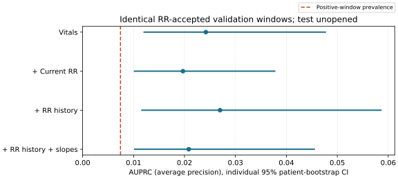
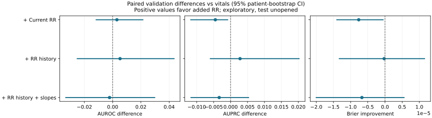

# M2 全量 ECG 與配對開發驗證結果

2026-11-01；protocol 0.3；固定工程 RR 第一版。340,354 個片段、五組開發模型與 200 次共同患者配對 bootstrap 已全部完成。

**目前沒有清楚證據顯示加入 RR 歷史或斜率能改善預測。** 歷史 RR 的 AUPRC 為 0.02698，相對同族群常規模型 0.02419 的差值為 0.00279，95% 配對區間 −0.00612 至 0.02035，仍跨越零。當下 RR 的 AUPRC 差值為 −0.00449，區間 −0.01190 至 −0.00071；這是未校正多重比較的探索性劣化，不能只呈現略高的 AUROC 點估計。三組比較全部列於下表，沒有依結果挑選勝出模型。

配對驗證只有 41 個事件，僅涵蓋完整風險觀察時間的 11.62%，實際誤報負擔亦不同。已知搏動定位問題尚未修復；142,489 個工程通過片段與 244 個覆蓋事件，**不能當作已驗證可靠的 NN-HRV 樣本數**。此輪也不能證明生理 HRV 沒有價值，只能說目前這套量測與模型尚未提供清楚的增益證據。

下一步先驗證定位時間、RR／RMSSD 誤差與品質拒絕規則，再建立新版本快取及相同 ECG 平均心率／歷史對照。資料與驗證安排見 [v2 訊號驗證準備](rr_validation_v2.md)；隊列、終點與全族群基準的細節見 [M2 紀錄](m2_results.md)。

完成狀態、彙總數量與模型來源指紋已核對；以下只呈現彙總，保留測試未開封。

## 訊號與事件覆蓋

| 項目 | 通過／分母 |
|---|---:|
| 全部計畫五分鐘片段通過工程篩選 | 142,489 / 340,354（41.86%） |
| 逐小時採樣五分鐘片段通過 | 126,664 / 301,753（41.98%） |
| 首個六小時預測點之前或當下事件（無預警機會） | 3,333 / 4,862（68.55%） |
| 至少一個歷史片段通過 | 325 / 1,529（21.26%） |
| 歷史合格片段累計至少 1 小時 | 262 / 1,529（17.14%） |
| 歷史合格片段累計至少 3 小時 | 182 / 1,529（11.90%） |
| 歷史完整 6 小時片段通過 | 3 / 1,529（0.20%） |
| 至少一個陽性逐小時更新點當下片段通過 | 244 / 1,529（15.96%） |

事件覆蓋分母為 1,529 個至少有一次合法陽性預測點的事件；全部首次事件為 4,862。歷史累計片段數不表示連續可用時間。密集事件稽核片段不進入模型。

| 分組／時窗結局 | 當下片段通過／完整風險時窗 |
|---|---:|
| 訓練／陽性 | 480 / 4,836（9.93%） |
| 訓練／陰性 | 70,153 / 589,358（11.90%） |
| 訓練／截尾 | 6,337 / 64,111（9.88%） |
| 開發驗證／陽性 | 121 / 1,219（9.93%） |
| 開發驗證／陰性 | 16,154 / 138,457（11.67%） |
| 開發驗證／截尾 | 1,750 / 16,173（10.82%） |
| 保留測試（僅覆蓋計數）／陽性 | 141 / 1,453（9.70%） |
| 保留測試（僅覆蓋計數）／陰性 | 21,322 / 179,103（11.90%） |
| 保留測試（僅覆蓋計數）／截尾 | 1,960 / 19,893（9.85%） |

## 工程拒絕原因與解碼問題

工程拒絕片段總數為 197,865。下列拒絕原因非互斥，同一片段可有多項原因，不能將各列相加當作片段總數；`ecg_decode_unavailable` 與 `detector_error` 也可能反映技術問題，不能全稱為臨床訊號品質不良。

| 工程拒絕原因代碼 | 出現該原因的片段數 |
|---|---:|
| `nonfinite_samples` | 62,421 |
| `suspected_clipping` | 57,775 |
| `too_many_screened_rr_intervals` | 53,527 |
| `insufficient_valid_rr_duration` | 41,472 |
| `low_block_beat_agreement` | 25,300 |
| `ecg_decode_unavailable` | 19,714 |
| `low_beat_agreement` | 13,320 |
| `insufficient_adjacent_rr_intervals` | 6,501 |
| `flat_run` | 4,777 |
| `low_block_amplitude` | 1,691 |
| `too_few_beats` | 130 |
| `incomplete_beat_span` | 107 |
| `detector_error` | 57 |
| `excessive_amplitude_range` | 5 |

解碼錯誤另表列出，代表資料、格式、通道或讀取的技術問題，不能歸為臨床品質差。每個代碼在單一片段內只計一次；不同代碼仍可重疊，不能相加當作失敗片段總數。其他重疊紀錄可能補足訊號，因此有解碼錯誤代碼的片段仍可能通過工程篩選。

| 解碼錯誤代碼 | 出現該錯誤的片段數 |
|---|---:|
| `no_decodable_lead_ii` | 19,048 |
| `lead_ii_absent` | 17,591 |
| `overlapping_signal_conflict` | 754 |
| `incompatible_sample_grids` | 241 |

## 相同 RR 通過時窗的四組配對模型

驗證患者 630 位、非截尾時窗 16,275 個、陽性事件 41 個；陽性時窗比例 0.00743。

| 模型 | AUROC [95% CI] | AUPRC [95% CI] | Brier [95% CI] |
|---|---:|---:|---:|
| 配對：常規資訊 | 0.59772 [0.45854, 0.71908] | 0.02419 [0.01195, 0.04778] | 0.00735 [0.00469, 0.01042] |
| 配對：加入當下 RR | 0.60074 [0.47003, 0.71790] | 0.01969 [0.01005, 0.03785] | 0.00736 [0.00469, 0.01043] |
| 配對：加入歷史 RR | 0.60297 [0.49516, 0.71620] | 0.02698 [0.01150, 0.05871] | 0.00735 [0.00468, 0.01042] |
| 配對：歷史 RR 與斜率 | 0.59553 [0.48301, 0.70610] | 0.02084 [0.01011, 0.04560] | 0.00736 [0.00468, 0.01042] |

## 相對配對常規模型的差值

三項正值均代表改善：AUROC／AUPRC 為加入 RR 減常規模型；Brier 為常規模型減加入 RR。

| 加入 RR 的模型 | ΔAUROC [95% CI] | ΔAUPRC [95% CI] | Brier 改善 [95% CI] |
|---|---:|---:|---:|
| 配對：加入當下 RR | 0.00301 [-0.01200, 0.02176] | -0.00449 [-0.01190, -0.00071] | -7.648e-06 [-1.417e-05, -3.996e-07] |
| 配對：加入歷史 RR | 0.00525 [-0.02541, 0.04383] | 0.00279 [-0.00612, 0.02035] | -2.366e-07 [-1.344e-05, 1.166e-05] |
| 配對：歷史 RR 與斜率 | -0.00220 [-0.03353, 0.03013] | -0.00335 [-0.01183, 0.00546] | -6.723e-06 [-2.016e-05, 5.696e-06] |

## 全風險集合生命徵象基準（族群不同，獨立呈現）

驗證患者 2,237 位、非截尾時窗 139,676 個；陽性時窗比例 0.00873。不能與上述配對模型直接相減宣稱 RR 增益。

| 指標 | 估計值 [95% CI] |
|---|---:|
| AUROC | 0.67984 [0.63586, 0.71749] |
| AUPRC | 0.02669 [0.01982, 0.03936] |
| Brier | 0.00859 [0.00729, 0.00959] |

| 全風險集合基準警報項目 | 數值及分母 |
|---|---:|
| 抓到／已評分事件 | 28 / 247（11.34%） |
| 抓到／完整風險事件 | 28 / 247（11.34%） |
| 訓練陰性第 99 百分位門檻 | 0.032882 |
| 抓到事件的提前中位／平均 | 2.646 / 2.781 小時 |
| 誤報數 | 373 |
| 已評分觀察病人小時；每 100 小時誤報 | 154,368.021；0.24163 |
| 結局可評估病人小時；每 100 小時誤報 | 139,549.051；0.26729 |
| 全部／真陽性／結局不明通知 | 457 / 28 / 56 |
| 六小時間隔抑制次數 | 779 |
| 已評分／完整風險時間（病人小時） | 154,368.021 / 154,368.021（100.00%） |

## 配對模型通知、事件與實際觀察時間

每組門檻固定為其訓練陰性分數第 99 百分位，ICU 內六小時不重複通知。不同模型實際誤報負擔可能不同，因此下列敏感度不構成相同誤報率比較。

| 模型 | 抓到／已評分事件 | 抓到／完整風險事件 | 門檻 | 提前中位／平均（小時） |
|---|---:|---:|---:|---:|
| 配對：常規資訊 | 5 / 41（12.20%） | 5 / 247（2.02%） | 0.025036 | 1.816 / 2.030 |
| 配對：加入當下 RR | 3 / 41（7.32%） | 3 / 247（1.21%） | 0.026654 | 1.816 / 2.731 |
| 配對：加入歷史 RR | 5 / 41（12.20%） | 5 / 247（2.02%） | 0.028315 | 2.598 / 2.792 |
| 配對：歷史 RR 與斜率 | 4 / 41（9.76%） | 4 / 247（1.62%） | 0.029411 | 2.885 / 3.286 |

| 模型 | 誤報數 | 已評分觀察病人小時 | 誤報／100 觀察小時 | 結局可評估病人小時 | 誤報／100 可評估小時 |
|---|---:|---:|---:|---:|---:|
| 配對：常規資訊 | 69 | 17,942.872 | 0.38455 | 16,262.617 | 0.42429 |
| 配對：加入當下 RR | 46 | 17,942.872 | 0.25637 | 16,262.617 | 0.28286 |
| 配對：加入歷史 RR | 68 | 17,942.872 | 0.37898 | 16,262.617 | 0.41814 |
| 配對：歷史 RR 與斜率 | 71 | 17,942.872 | 0.39570 | 16,262.617 | 0.43658 |

| 模型 | 全部通知 | 真陽性通知 | 結局不明通知 | 間隔抑制次數 | 已評分時間／完整風險時間 |
|---|---:|---:|---:|---:|---:|
| 配對：常規資訊 | 81 | 5 | 7 | 63 | 17,942.872 / 154,368.021（11.62%） |
| 配對：加入當下 RR | 57 | 3 | 8 | 35 | 17,942.872 / 154,368.021（11.62%） |
| 配對：加入歷史 RR | 78 | 5 | 5 | 21 | 17,942.872 / 154,368.021（11.62%） |
| 配對：歷史 RR 與斜率 | 81 | 4 | 6 | 16 | 17,942.872 / 154,368.021（11.62%） |

## 第一版限制

- 預測的是已記錄的首次持續升壓劑開始使用，不能等同敗血性休克診斷、實際治療需求或一般病況惡化。不同 ICU 與藥物使用情境混合，需要臨床分層審查。
- ICU 前六小時的事件無法由目前第一個預測點預警；品質不足時窗不出分，完整族群效益不能只看通過品質的配對分數。
- 工程品質通過不代表正常 NN 心搏；尚未確認 AF、pacing、異位心搏或 R 波偵測的臨床準確率。候選 mean RR、SDRR、RMSSD of RR 尚不是經心律確認的 NN-HRV。
- 本輪六例固定訓練樣本重現結果為 6／6 一致，但其中兩個工程接受樣本已觀察到 XQRS／GQRS 定位與 RMSSD 明顯不一致（62.22／5.75 ms、49.61／18.19 ms）。GQRS 不是標註真值，此小型分層抽查不能外推發生比例；目前工程通過不足以證實 HRV 可靠性，需另外驗證搏動定位與正常心律。
- 模型使用六個逐小時的五分鐘片段，不是連續六小時 HRV；歷史斜率也可能只重表達既有資訊。
- RR 模型包含 mean_rr_ms、rr_valid_count 與缺失指標；相對僅有當下生命徵象的基準，任何增益可能來自更即時的心率、歷史資訊或資料可用性，不能單獨歸因於 HRV 變異。下一版應另設同一 ECG 來源、相同歷史的平均心率控制組；本報告未新增模型或變更既有 variants。
- 誤報分母只含實際已評分時窗的下一小時，按暴露／追蹤終止截短；品質拒絕時間不在配對誤報分母。結局不明通知不能當陰性。
- 配對差值為探索性共同患者 bootstrap：要求 200 次、有效 200 次、單一類別略過 0 次；不重訓，區間不含訓練不確定性，未校正三組多重比較。個別模型區間重疊不能代替配對差值分析。
- 保留測試未開封；尚無外部驗證、相同實際誤報負擔下的確認性比較或臨床效益證據。沒有依本報告自動選勝出模型。

全風險集合：常規資訊個別區間：有效 100／100 次患者 bootstrap；收斂警告：無。

配對：常規資訊個別區間：有效 100／100 次患者 bootstrap；收斂警告：無。

配對：加入當下 RR個別區間：有效 100／100 次患者 bootstrap；收斂警告：無。

配對：加入歷史 RR個別區間：有效 100／100 次患者 bootstrap；收斂警告：無。

配對：歷史 RR 與斜率個別區間：有效 100／100 次患者 bootstrap；收斂警告：無。
